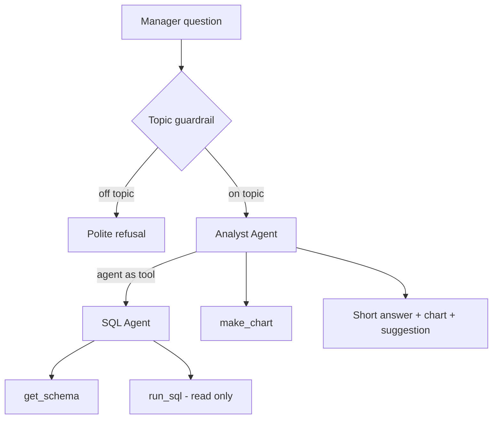

# Data Analyst Agent

A sales analyst you can talk to. A shop manager asks a question in plain English, for example "Which city sold the most?" or "Show the monthly sales trend". The agent writes the SQL, runs it on the sales database, draws a chart when it helps, and answers in a few short lines with a suggestion.

I built this because most small business owners I know have their numbers sitting in a database or spreadsheet but cannot query it themselves. They wait for someone to make a report. This removes the wait for the common questions.

Live demo: https://data-analyst-agent-g6uh.onrender.com/

## What it does

- Answers questions about sales, products, cities, channels, returns and monthly trends
- Generates a bar or line chart when the answer compares several items
- Remembers the conversation, so follow-ups like "and the lowest?" work
- Refuses questions that have nothing to do with the sales data
- Can only read the database. It cannot change or delete anything

## How it works



There are two agents. The **SQL Agent** has one job: turn a question into a correct SQLite query and return the real result. The **Analyst Agent** is the one the user talks to. It calls the SQL Agent as a tool, decides whether a chart is useful, and writes the final answer for a non-technical reader.

Built with the OpenAI Agents SDK, using Gemini through its OpenAI-compatible endpoint, FastAPI, SQLite, pandas and matplotlib. Dependencies are managed with uv.

## Design decisions

**Agent as a tool, not a handoff.** In my previous project (a customer support system) I used handoffs, where control passes to a specialist. Here the Analyst needs the SQL result back so it can explain it and chart it, so the SQL Agent is called like a function and returns its output.

**Safety in three layers.** The obvious risk with an LLM writing SQL is that it writes `DROP TABLE` or `DELETE`. I do not rely on the prompt to stop that:
1. The database connection is opened in read-only mode (`mode=ro`).
2. Only queries starting with `SELECT` or `WITH` are accepted, and only one statement at a time.
3. Words like `DELETE`, `UPDATE`, `DROP`, `ATTACH` and `PRAGMA` are rejected before the query runs.

**Defining "sales" once.** Early on the agent gave different totals for the same question, sometimes counting cancelled orders, sometimes not. I put the definition in the instructions: sales means `SUM(total_amount)` where `status = 'delivered'`. The answers became consistent.

**Fewer model calls.** Each question originally made about seven calls to the model. I put the fixed table schema directly in the SQL Agent's instructions instead of making it call `get_schema` every time, and run the topic guardrail in parallel with the main agent. Answers got noticeably faster.

**Errors the model can recover from.** When a query fails, the tool returns the SQLite error plus a hint to check the schema. The agent reads it, fixes the column name, and tries again.

**Model chosen by configuration.** The model name is read from an environment variable, so I can switch models without touching code.

## Project structure

```
create_data.py      builds the demo sales database (600 orders, Jan-Sep 2026)
config.py           Gemini client and model (model name from .env)
tools.py            get_schema, run_sql, read-only connection and SQL safety check
chart_tool.py       make_chart: bar or line chart saved as PNG
sql_agent.py        SQL Agent
guardrails.py       input guardrail for off-topic questions
analyst_agent.py    Analyst Agent (uses SQL Agent as a tool)
main.py             terminal chat with memory
api.py              FastAPI app: /ask, /health, serves the page and charts
static/index.html   chat page
test_tools.py       tests tools and safety checks, no API calls
test_chart.py       tests chart generation, no API calls
test_sql_agent.py   asks the SQL Agent two questions
ping_gemini.py      one-request check that the API key and model work
list_model.py       lists the models available to the API key
```

## Running locally

Requires [uv](https://docs.astral.sh/uv/).

```bash
git clone https://github.com/Komal-Mustafa/Data_Analyst_Agent.git
cd Data_Analyst_Agent
uv sync
```

Copy `.env.example` to `.env` and add your Gemini API key. Then:

```bash
uv run create_data.py               # build the demo database
uv run test_tools.py                # check tools and safety (no API calls)
uv run ping_gemini.py               # check the key and model
uv run main.py                      # chat in the terminal
uv run uvicorn api:app --reload     # web app at http://127.0.0.1:8000
````

## Example

````
You: Which city had the highest sales?

Analyst: Islamabad had the highest delivered sales at Rs 1,655,000.
- Multan is second with Rs 1,511,400.
- Faisalabad is lowest at Rs 1,151,500, about 30% below Islamabad.
Suggestion: Look at what is selling in Islamabad and test the same promotion in Faisalabad.

You: Can you help me with my physics homework?
Analyst: I can only answer questions about the shop's sales data.
````

## Problems I ran into

**Free tier limits.** The Gemini free tier allows 20 requests per day per model, and one question uses several of them. I wrote the tool tests so they run without the model and kept agent tests to one or two questions at a time. The limit is per model, so I can switch models through `.env` when one runs out.

**An overloaded model.** For two days the model I started with returned 503 errors or timed out. I wrote a one-request ping script to tell apart "my code is broken", "my internet is down" and "the model is busy", then moved the model name into `.env` so switching takes one line. I also set a timeout and a small retry count so users get a clear message in about 30 seconds instead of waiting minutes.

**A stale environment variable.** After changing the model in `.env`, the app kept using the old one. The editor had loaded `.env` into the terminal when it opened, and `load_dotenv()` does not override existing variables. `load_dotenv(override=True)` fixed it.

**SQLite dates.** The model kept writing MySQL date functions like `MONTH(order_date)`, which do not exist in SQLite. One line in the instructions, telling it to use `strftime('%Y-%m', order_date)`, fixed it.

**Finding the chart in the response.** The model sometimes mentioned the chart's file path in its answer and sometimes did not. Instead of parsing the text, the chart tool returns `CHART_FILE: <path>`, and the API looks for that in the tool outputs.

## Limitations and what I would add next

- The data is a generated demo set. Connecting a real Postgres or MySQL database would mostly mean changing `get_connection()`.
- On the free hosting plan, charts and conversation memory are lost when the server restarts.
- The SQL keyword check is a blocklist. For production I would also use a database user that only has SELECT permission.
- There are no automated evaluations yet. Next I want a set of 20 questions with known answers and a script that checks the agent's numbers against them.
- Add CSV upload so a manager can analyse their own file.

## Author

Komal Mustafa
````

**3.** Fix **lines 77–78** to your real repo name:
````
git clone https://github.com/Komal-Mustafa/Data_Analyst_agent.git
cd Data_Analyst_agent
````

**4.** Save with **Ctrl+S**.

## Step C: push it
Make sure the terminal shows `PS D:\data_analyst_agent>`, then:
````
git add README.md
git commit -m "Complete README"
git push
````

✅ **Success looks like:** `main -> main` at the end, **not** "nothing to commit".

Send me a screenshot of the terminal after Step C. 🙂              # check the